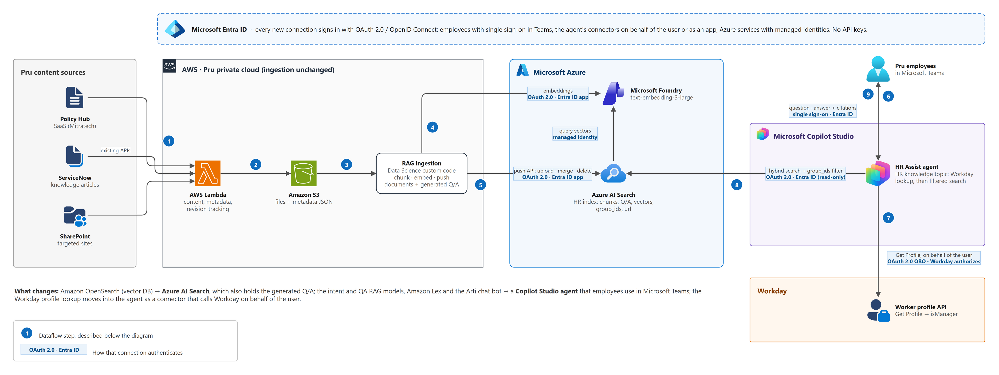
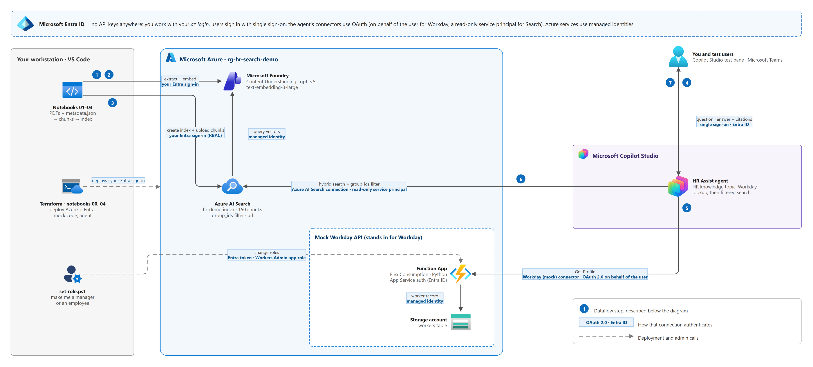
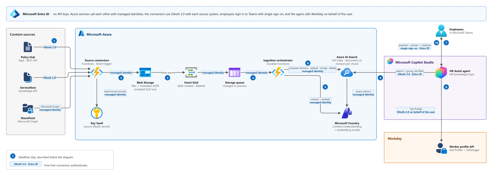

# Architecture

Three views of the same idea: an Azure AI Search index holds the HR content, and a
Copilot Studio agent that employees use in Microsoft Teams answers from it, showing
manager-only documents only to people Workday says are managers. Every connection
signs in with Microsoft Entra ID (OAuth 2.0 / OpenID Connect, or a managed identity);
nothing uses an API key.

| Diagram | What it shows | Status |
|---|---|---|
| [1. Target](#1-target-architecture) | The customer's current architecture with only the serving side replaced: their AWS ingestion pushes to Azure AI Search instead of OpenSearch, and a Copilot Studio agent takes over from the RAG models, Lex and the chat bot. Workday stays. | Design |
| [2. Demo](#2-demo-architecture) | What this repo deploys: notebooks build the index, and a mock Workday API stands in for Workday. | Deployed and tested |
| [3. Native Azure](#3-native-azure-architecture) | The same agent, with ingestion moved to Azure too: event-driven and keyless. | Design |

How to read them:

- A **numbered circle** is a step in the dataflow listed under the diagram.
- A **blue label** on a line says how that connection signs in.
- A **dashed line** (demo only) is a deployment or admin call, not part of answering
  a question.

Each PNG has an editable `.drawio` file next to it; open it in
[draw.io](https://www.drawio.com) or VS Code's Draw.io Integration extension. The icons
are Microsoft's official [Azure](https://learn.microsoft.com/azure/architecture/icons/),
[Microsoft Entra](https://learn.microsoft.com/entra/architecture/architecture-icons),
[Power Platform](https://learn.microsoft.com/power-platform/guidance/icons) and
[Microsoft 365](https://learn.microsoft.com/previous-versions/microsoft-365/solutions/architecture-icons-templates)
icon sets, plus draw.io's AWS shapes.

## 1. Target architecture

*Download the [draw.io file](1-target-architecture.drawio).*

Ingestion stays on AWS as it is today. What changes:

- **Amazon OpenSearch → Azure AI Search.** The RAG ingestion code pushes its chunks
  with the push API instead of the OpenSearch client. The Data Science team's
  generated Q/A goes into the same index, so it needs no database of its own.
- **Intent and QA RAG models, Amazon Lex, the Arti chat bot → one Copilot Studio
  agent,** used in Microsoft Teams. Teams is the only front end, so there's no web app
  to host.
- **The Workday profile lookup moves into the agent,** as a connector that calls
  Workday on behalf of the user.

### Dataflow

1. AWS Lambda functions pull content and metadata from Policy Hub, ServiceNow and the
   targeted SharePoint sites through their existing APIs, and track revisions and new
   content. *(Unchanged.)*
2. Lambda writes each file and its metadata JSON to Amazon S3. *(Unchanged.)*
3. The Data Science team's RAG ingestion code reads from S3, chunks the documents and
   produces the generated Q/A. *(Unchanged.)*
4. It gets embeddings from the text-embedding-3-large deployment in Microsoft Foundry,
   signed in as a Microsoft Entra ID app.
5. It pushes the chunks and the generated Q/A to the HR index with the push API
   (upload, merge, delete), as the same app. Each chunk carries `group_ids` (who may
   read it) and `url` (its citation).
6. An employee asks HR Assist a question in Teams, signed in with single sign-on.
7. The agent's HR knowledge topic calls Workday's **Get Profile** on behalf of the
   employee. Workday sees who is asking and returns `isManager`.
8. The topic runs a hybrid search on the index, filtered on `group_ids` by
   `isManager`. Search turns the question into a vector with the same embedding model,
   using its managed identity.
9. Copilot Studio writes the answer from the returned chunks and cites each one's `url`.

### Components

- [Azure AI Search](https://learn.microsoft.com/azure/search/search-what-is-azure-search)
  holds the HR index: chunks, generated Q/A, vectors, the `group_ids` security filter
  and `url` for citations. It replaces OpenSearch.
- [Microsoft Foundry](https://learn.microsoft.com/azure/ai-foundry/what-is-azure-ai-foundry)
  serves text-embedding-3-large for both document and query vectors.
- [Microsoft Copilot Studio](https://learn.microsoft.com/microsoft-copilot-studio/fundamentals-what-is-copilot-studio)
  hosts the HR Assist agent and publishes it to Teams. One topic does the Workday
  lookup and the filtered search; see [Copilot Studio](../README.md#copilot-studio).
- [Microsoft Entra ID](https://learn.microsoft.com/entra/fundamentals/whatis) signs in
  the employees, the ingestion app and the agent's connections, and issues the
  on-behalf-of token for Workday.
- **Workday**'s worker profile API says whether the employee is a manager.

### Authentication

| Connection | Signs in as | How |
|---|---|---|
| Employee → agent | the employee | Teams single sign-on (Entra ID) |
| Agent → Workday | the employee, through the Workday connector | OAuth 2.0 on-behalf-of: the call runs as the employee, so Workday applies its own permissions |
| Agent → Azure AI Search | the agent's search connection | Entra ID service principal with **Search Index Data Reader**, as in the demo |
| RAG ingestion → Azure AI Search | an Entra ID app | OAuth 2.0 client credentials, **Search Index Data Contributor** |
| RAG ingestion → Foundry | the same app | OAuth 2.0 client credentials, **Cognitive Services OpenAI User** |
| Azure AI Search → Foundry | Search's managed identity | **Cognitive Services OpenAI User** |

The ingestion app's certificate or client secret is the only credential on the AWS
side.

## 2. Demo architecture

*Download the [draw.io file](2-demo-architecture.drawio).*

What this repo deploys. Notebooks play the RAG ingestion code, and a small Azure
Function stands in for Workday. [Run](../README.md#run) has the steps.

### Dataflow

1. Notebook 01 sends each PDF to Content Understanding in Microsoft Foundry
   (`prebuilt-documentSearch`, with gpt-5.5 behind it), gets Markdown back and splits
   it by titles and sections.
2. Notebook 01 embeds the chunks with text-embedding-3-large (3,072 dimensions).
3. Notebook 02 creates the `hr-demo` index; notebook 03 uploads the chunks and tries
   some searches as an employee and as a manager.
4. You or a test user ask HR Assist a question in the Copilot Studio test pane or in
   Teams.
5. The topic calls the mock Workday's **Get Profile** through the Workday (mock)
   connector, on behalf of the user. App Service authentication checks the token,
   and the function returns that user's record from the workers table.
6. The topic runs a semantic hybrid search filtered on `group_ids`, over the Azure AI
   Search connection.
7. The agent answers and cites each chunk's `url`.

The dashed lines are setup: Terraform creates the Azure and Entra resources, notebook
00 publishes the mock's code, notebook 04 deploys the connector and the agent, and
`set-role.ps1` makes you a manager or an employee in the mock.

### Authentication

| Connection | How | Set up by |
|---|---|---|
| Notebooks, Terraform → Azure | your `az login` | you |
| Notebooks → Foundry, Search | your sign-in, with **Cognitive Services User**, **Search Service Contributor** and **Search Index Data Contributor** | Terraform |
| Azure AI Search → Foundry | Search's managed identity, **Cognitive Services OpenAI User** | Terraform |
| User → agent | single sign-on | Copilot Studio |
| Agent → mock Workday | Workday (mock) connector: OAuth 2.0 on-behalf-of, `Workers.Read` | Terraform (app registrations), notebook 04 (connector) |
| Agent → Azure AI Search | Azure AI Search connection: service principal with **Search Index Data Reader** | Terraform (service principal), notebook 04 (connection) |
| Function → workers table | the function's managed identity; the storage account has shared keys off | Terraform |
| `set-role.ps1` → mock Workday | your sign-in, with the **Workers.Admin** app role | Terraform |

Search, Foundry and the storage account have key access turned off. Two client
secrets exist, for the connector's app and the search service principal; each goes
from Terraform's state straight into its Power Platform connection.

## 3. Native Azure architecture

*Download the [draw.io file](3-native-azure-architecture.drawio).*

Ingestion moves to Azure as well, driven by events and with no keys. The agent,
Teams and Workday are the same as in the target. The index is the only store: each
chunk keeps its `document_id` and `revision`, so the pipeline asks the index what it
already has instead of keeping a tracking database.

### Dataflow

1. Source connectors (Azure Functions on a timer) pull new and changed content from
   Policy Hub and ServiceNow with OAuth 2.0, using client secrets kept in Key Vault,
   and from SharePoint through Microsoft Graph with the function's managed identity.
2. They write each file and its metadata JSON to Blob Storage. Scripted Q/A goes in
   the same way, as documents.
3. Blob Storage publishes *blob created* and *blob deleted* events to Event Grid.
4. Event Grid delivers each event to a Storage queue, and the queue starts the
   ingestion orchestrator (Durable Functions).
5. The orchestrator extracts the file with Content Understanding and embeds the
   chunks, in Microsoft Foundry.
6. It compares the file's `revision` with what the index holds for that `document_id`,
   then uploads, merges or deletes chunks in Azure AI Search. A deleted file removes
   its chunks.
7. An employee asks HR Assist a question in Teams, signed in with single sign-on.
8. The topic calls Workday's **Get Profile** on behalf of the employee.
9. It searches the index, filtered on `group_ids` by `isManager`.
10. The agent answers and cites each chunk's `url`.

### Components

Beyond those in the target:

- [Azure Functions](https://learn.microsoft.com/azure/azure-functions/functions-overview)
  runs the source connectors on a timer, and the ingestion orchestrator as
  [Durable Functions](https://learn.microsoft.com/azure/azure-functions/durable/durable-functions-overview),
  which retries and checkpoints the extract, embed and index steps per file.
- [Azure Key Vault](https://learn.microsoft.com/azure/key-vault/general/overview) keeps
  the OAuth client secrets for Policy Hub and ServiceNow.
- [Azure Blob Storage](https://learn.microsoft.com/azure/storage/blobs/storage-blobs-overview)
  is the landing zone: files plus metadata JSON, like S3 today.
- [Azure Event Grid](https://learn.microsoft.com/azure/event-grid/overview) turns blob
  changes into events.
- [Azure Queue Storage](https://learn.microsoft.com/azure/storage/queues/storage-queues-introduction)
  buffers the changes, so a burst of files is processed at the orchestrator's pace.
- [Content Understanding](https://learn.microsoft.com/azure/ai-services/content-understanding/overview)
  in Microsoft Foundry extracts Markdown from each file, as notebook 01 does in the demo.

### Authentication

| Connection | How |
|---|---|
| Connectors → Policy Hub, ServiceNow | OAuth 2.0 with each system; the client secrets are in Key Vault |
| Connectors → SharePoint | Microsoft Graph with the function's managed identity, granted `Sites.Selected` on the targeted sites |
| Connectors → Key Vault, Blob Storage | managed identity, **Key Vault Secrets User**, **Storage Blob Data Contributor** |
| Event Grid → Storage queue | the Event Grid system topic's managed identity, **Storage Queue Data Message Sender** |
| Storage queue → orchestrator | identity-based connection with the function's managed identity |
| Orchestrator → Foundry, Azure AI Search | managed identity, **Cognitive Services User**, **Search Index Data Contributor** |
| Azure AI Search → Foundry | Search's managed identity, **Cognitive Services OpenAI User** |
| Employee → agent → Workday, Search | as in the [target](#authentication) |

Event Grid delivers to a queue rather than calling a function directly because an
Event Grid–triggered function's endpoint URL
[carries a system key](https://learn.microsoft.com/azure/azure-functions/event-grid-how-tos#obtain-the-system-key).
Event Grid can [deliver to a Storage queue with its managed identity](https://learn.microsoft.com/azure/event-grid/managed-service-identity),
and the queue trigger reads it with the function's, so nothing on this path holds a
key. Failed messages are retried and then moved to a poison queue.
